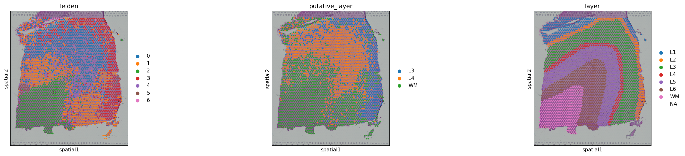
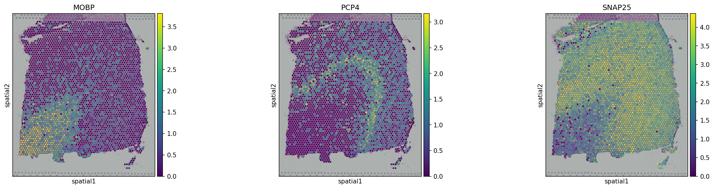
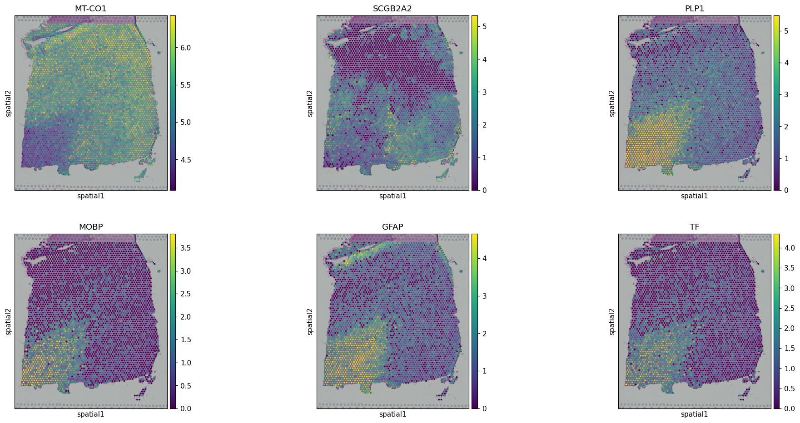

# Spatial Transcriptomics Analysis of Human Brain Tissue

A 10x Visium analysis of human dorsolateral prefrontal cortex (DLPFC) from the
public **spatialLIBD** release (Maynard et al. 2021): QC, normalization, Leiden
clustering, spatially variable genes (Squidpy Moran's I), and a measured
comparison of the unsupervised clusters against the manually annotated cortical
layers (L1-L6, white matter).

**Stack:** Scanpy · Squidpy · scikit-learn · 10x Visium
**Author:** Arash Mehrabi Parsa

Every number below was produced by running this repository's code on CPU
(`python run_pipeline.py --steps load qc normalize cluster svg`). The tables are
committed under `results/` and the figures under `results/figures/`.

---

## Data

**spatialLIBD DLPFC, section 151673** (donor Br8100), 10x Visium, Maynard et al.
2021, *Nat Neurosci*. `scripts/download_data.py` fetches:

| File | Source |
|------|--------|
| `filtered_feature_bc_matrix.h5` | public spatialLIBD S3 bucket (`spatial-dlpfc`) |
| `spatial/tissue_hires_image.png` | public spatialLIBD S3 bucket |
| `spatial/tissue_lowres_image.png`, `tissue_positions_list`, `scalefactors_json.json` | `LieberInstitute/HumanPilot` GitHub repo, `10X/151673/` |
| `layer_annotations.tsv` (manual layer label per spot) | `LieberInstitute/HumanPilot`, `10X/barcode_level_layer_map.tsv` |

Downloads go to `data/151673/`, which is git-ignored. About 20 MB in total.

---

## Results (section 151673)

### QC

| | Spots | Genes |
|---|---|---|
| Raw (in-tissue, Space Ranger filtered) | 3,639 | 33,538 |
| After QC | **3,633** | **19,151** |

Filters: at least 200 detected genes per spot, mitochondrial fraction below 30%,
genes detected in at least 3 spots. The mitochondrial cutoff was set from the
measured distribution, not from clustering scores: the median spot in this
section has 16.7% mitochondrial reads (75th percentile 19.4%), and the common
20% cutoff removed 741 of 3,639 spots, mostly from L1-L3. 3,611 spots carry a
manual layer label; 3,605 of those pass QC and are used for scoring.

Normalization: `normalize_total` (10,000 counts) + `log1p`, 2,000 highly
variable genes (Seurat flavor), scaling, 50 PCs, 15-neighbor graph, UMAP.

### Clusters vs. manual cortical layers

Leiden on the expression neighbor graph (no spatial smoothing), scored on the
3,605 annotated spots that pass QC:

| Leiden resolution | Clusters | ARI | NMI |
|---|---|---|---|
| 0.2 | 2 | 0.137 | 0.315 |
| 0.3 | 2 | 0.140 | 0.310 |
| 0.4 | 2 | 0.142 | 0.309 |
| 0.5 | 3 | 0.158 | 0.270 |
| 0.6 | 3 | 0.150 | 0.258 |
| **0.8 (default)** | **7** | **0.206** | **0.302** |
| 1.0 | 8 | 0.225 | 0.310 |

Source: `results/ari_vs_layers.csv`. Cluster-by-layer spot counts:
`results/cluster_vs_layer_counts.csv`.

What the counts show at resolution 0.8: white matter is recovered well (cluster
2 holds 510 of the 513 annotated WM spots that pass QC, plus 229 L6 spots).
The grey-matter layers are not separated cleanly: clusters 0, 1, 3 and 4 each
span three or more layers. This is the expected weakness of expression-only
clustering on Visium; spatially aware methods (BayesSpace, SpaGCN, GraphST and
others) are built to close this gap and are not run here.

The marker-score heuristic in `src/cluster.py` (`putative_layer`) labels
clusters only as L3, L4 or WM on this section and calls cluster 1 (mostly L5/L6
spots) "WM". It is a weak heuristic and is reported in
`results/cluster_layer_annotation.csv` only for transparency; the manual
annotation is the reference.

### Marker check by manual layer

Mean log1p(CP10k) expression per annotated layer (`results/marker_by_layer.csv`):

| Layer | MOBP | PCP4 | SNAP25 |
|---|---|---|---|
| L1 | 0.240 | 0.380 | 2.604 |
| L2 | 0.285 | 0.742 | 3.134 |
| L3 | 0.291 | 0.712 | 3.282 |
| L4 | 0.444 | 0.882 | 3.410 |
| L5 | 0.512 | **1.464** | **3.535** |
| L6 | 1.057 | 0.509 | 3.180 |
| WM | **2.647** | 0.205 | 2.136 |

- **MOBP** (myelin, oligodendrocytes) peaks in WM, 2.5x the L6 value and about
  10x L1-L3.
- **PCP4** peaks in L5, as expected for deep-layer pyramidal neurons.
- **SNAP25** (pan-neuronal) is highest across L2-L6 grey matter and lowest in WM.

All three match the expected laminar pattern.

### Spatially variable genes (Squidpy Moran's I)

Moran's I on the 2,000 HVGs with a 6-neighbor Visium grid graph and 100
permutations (`results/moran_svgs.csv`): 553 genes have normal-approximation
BH-FDR < 0.05. Top 10 by Moran's I: MT-CO1 (0.711), SCGB2A2 (0.703), PLP1
(0.698), MOBP (0.645), GFAP (0.623), TF (0.591), CNP (0.570), CRYAB (0.556),
MAG (0.546), PPP1R14A (0.531). Most of the top genes are oligodendrocyte or
myelin genes (PLP1, MOBP, TF, CNP, MAG), which trace the white-matter boundary.
PCP4, the L5 marker, has Moran's I 0.297.

### Figures

| Figure | File |
|---|---|
| Leiden clusters, heuristic layer, and manual layers on the tissue | `results/figures/spatial_clusters.png` |
| UMAP colored by the same three labels | `results/figures/umap_clusters.png` |
| MOBP / PCP4 / SNAP25 on the tissue | `results/figures/marker_spatial.png` |
| Layer marker dot plot by manual layer | `results/figures/marker_dotplot_by_layer.png` |
| Top 6 Moran's I SVGs on the tissue | `results/figures/moran_top_svgs.png` |
| QC distributions | `results/figures/qc_violin.png`, `results/figures/qc_scatter.png` |





### Not run

- **SpatialDE** is implemented in `src/spatial_genes.py` but disabled in
  `config.yaml` (`svg.run_spatialde: false`) and was not run.
- **cell2location deconvolution** (`src/deconvolution.py`) needs a labeled
  snRNA-seq reference and was not run. No deconvolution results are reported.
- Only one section (151673) was analyzed.

---

## Reproduce

```bash
python -m venv .venv
source .venv/bin/activate      # Windows: .venv\Scripts\activate
pip install -r requirements.txt

python scripts/download_data.py              # -> data/151673/
python run_pipeline.py --steps load qc normalize cluster svg
```

Runs on CPU in a few minutes; the Moran's I permutation test is the slowest
step. Another spatialLIBD section can be fetched with
`python scripts/download_data.py --sample 151507` and selected with
`data.sample_id` in `config.yaml`.

`environment.yml` and `Dockerfile` are provided but were not used for the
reported run (see `requirements.txt` for the versions that were).

---

## Repository layout

```
├── config.yaml              # all parameters
├── run_pipeline.py          # step runner (load, qc, normalize, cluster, svg, deconv)
├── scripts/download_data.py # fetch spatialLIBD section + layer labels
├── src/
│   ├── io_utils.py          # Visium loading + layer-label attachment
│   ├── qc.py
│   ├── normalize.py
│   ├── cluster.py           # Leiden, ARI/NMI vs layers, marker check
│   ├── spatial_genes.py     # Moran's I (+ optional SpatialDE)
│   └── deconvolution.py     # cell2location (not run)
├── notebooks/01_walkthrough.py
└── results/                 # committed CSV tables + figures/ (AnnData objects ignored)
```

---

## References

- Maynard KR, Collado-Torres L, Weber LM, et al. *Transcriptome-scale spatial
  gene expression in the human dorsolateral prefrontal cortex.* Nat Neurosci
  24, 425-436 (2021). https://doi.org/10.1038/s41593-020-00787-0
- Palla G, Spitzer H, Klein M, et al. *Squidpy: a scalable framework for spatial
  omics analysis.* Nat Methods 19, 171-178 (2022).
  https://doi.org/10.1038/s41592-021-01358-2
- Wolf FA, Angerer P, Theis FJ. *SCANPY: large-scale single-cell gene expression
  data analysis.* Genome Biol 19, 15 (2018).
- Traag VA, Waltman L, van Eck NJ. *From Louvain to Leiden: guaranteeing
  well-connected communities.* Sci Rep 9, 5233 (2019).

## License

MIT, see [LICENSE](LICENSE).
