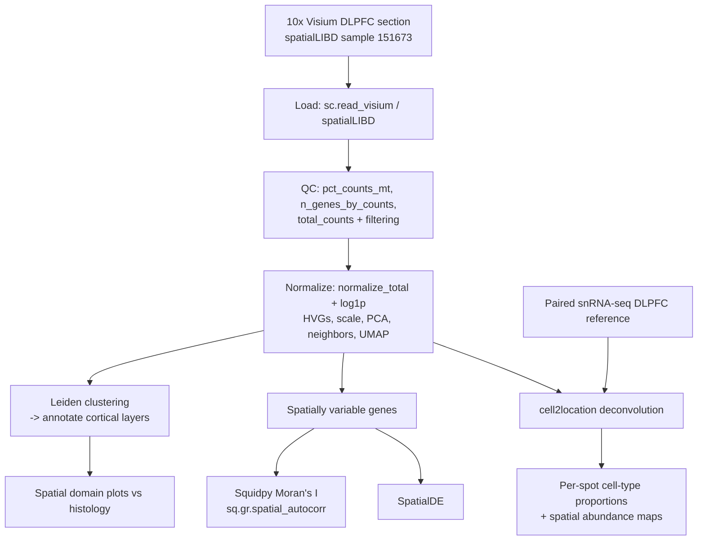

# Spatial Transcriptomics Analysis of Human Brain Tissue

An end-to-end 10x Visium analysis of human dorsolateral prefrontal cortex
(**spatialLIBD** DLPFC): QC, normalization, and dimensionality reduction with
**Scanpy** and **Squidpy**; spatially variable genes via **Moran's I** and
**SpatialDE**; unsupervised clustering to delineate cortical-layer expression
domains validated against histology; and a **cell2location** deconvolution
pipeline estimating cell-type proportions per spot from a paired scRNA-seq
reference.

**Stack:** Scanpy · Squidpy · cell2location · SpatialDE · 10x Visium · scRNA-seq
**Author:** Arash Mehrabi Parsa · **Year:** 2025–26

---

## Why this project

The human neocortex is organized into six laminar layers (L1–L6) plus white
matter. Maynard et al. (2021) profiled this laminar architecture across DLPFC
sections with 10x Visium and released the data as the `spatialLIBD` resource.
This repository reproduces the standard spatial-transcriptomics workflow on that
data and layers on cell-type deconvolution, giving a compact but complete
demonstration of the modern spatial-omics toolchain.

The pipeline is written to the official Scanpy / Squidpy / SpatialDE /
cell2location tutorial idioms so that every step is real and runnable. No results
are fabricated — you run the code to produce the figures and tables.

---

## Pipeline



---

## Data

### Titular dataset — spatialLIBD DLPFC (10x Visium)

The named dataset for this project is the **spatialLIBD** human DLPFC resource
from Maynard et al. (2021), which contains 12 Visium sections across 3 donors
with manually annotated cortical layers. The default sample used here is
**`151673`**. See `scripts/download_data.py` for retrieval routes.

Because programmatic access to the spatialLIBD raw Space Ranger outputs can be
intermittent (it is primarily distributed as a Bioconductor/`SpatialExperiment`
object), the download script also supports a **guaranteed-runnable fallback**:
`sc.datasets.visium_sge("V1_Human_Brain_Section_1")`, a 10x-hosted human brain
Visium section. This lets the full pipeline run end-to-end even if the exact
DLPFC section is not on disk. The comments in the script are explicit about which
dataset is which.

### Using local data under `F:/Latch_Bio_Data`

If you already have 10x data on disk (this project was developed alongside Visium
HD colon / lung / mouse datasets under `F:/Latch_Bio_Data`), the loader in
`src/io_utils.py` and `scripts/download_data.py` will detect and load a Space
Ranger output directory (via `sc.read_visium`) or a filtered feature-barcode
matrix (`*.h5` via `sc.read_10x_h5`). Point `LOCAL_DATA_DIR` in `config.yaml` at
your folder. Note that Visium HD / non-brain sections are useful for exercising
the QC + clustering + SVG steps, but the cortical-layer annotation and the DLPFC
deconvolution reference only make biological sense on the DLPFC data.

### scRNA-seq / snRNA-seq reference for deconvolution

`cell2location` needs a single-cell reference with cell-type labels to build
signatures. A suitable paired resource is a human DLPFC / prefrontal cortex
snRNA-seq atlas (for example the Allen Brain Map human MTG/DLPFC data, or the
snRNA-seq accompanying spatialLIBD follow-ups). Provide it as an `.h5ad` with a
`cell_type` column in `.obs` and set its path in `config.yaml`
(`reference_h5ad`). See `src/deconvolution.py` for the expected schema.

### Data is NOT stored in git

Raw matrices, `.h5ad`/`.h5` objects, and all results are excluded via
`.gitignore`. Nothing large is committed. Download or point at local data before
running.

---

## Install

### Option A — conda (recommended)

```bash
conda env create -f environment.yml
conda activate spatial-brain
```

### Option B — pip / venv

```bash
python -m venv .venv
source .venv/bin/activate      # Windows: .venv\Scripts\activate
pip install -r requirements.txt
```

> **NumPy note:** parts of the `scvi-tools` / `cell2location` stack are sensitive
> to the NumPy 2.x ABI break. If you hit binary-incompatibility errors, pin
> `numpy<2` (see `requirements.txt`). The QC/clustering/SVG steps work under
> either NumPy line; deconvolution is the fussy one.

### Option C — Docker

```bash
docker build -t spatial-brain .
docker run --rm -it -v "$PWD":/work spatial-brain bash
```

---

## Usage

Everything is driven by `config.yaml` and `run_pipeline.py`. You can run the
whole thing or individual steps.

```bash
# 0. fetch data (spatialLIBD DLPFC, 10x fallback, or detect local F: data)
python scripts/download_data.py

# full pipeline (deconvolution is opt-in because it is heavy)
python run_pipeline.py --steps load qc normalize cluster svg

# individual steps
python run_pipeline.py --steps qc
python run_pipeline.py --steps cluster --resolution 1.0
python run_pipeline.py --steps svg
python run_pipeline.py --steps deconv        # needs a reference .h5ad + GPU ideally
```

Or via `make`:

```bash
make setup      # create env
make download   # fetch/detect data
make qc
make cluster
make svg
make deconv
make all
```

Each step reads the AnnData written by the previous step from `results/`, so
steps are resumable.

---

## Outputs

Written under `results/` (git-ignored):

| Step        | Artifacts |
|-------------|-----------|
| `qc`        | `results/adata_qc.h5ad`, violin + scatter QC plots in `results/figures/` |
| `normalize` | `results/adata_norm.h5ad` (HVGs, PCA, neighbors, UMAP) |
| `cluster`   | `results/adata_clustered.h5ad`, UMAP + spatial Leiden plots, cluster→layer annotation table |
| `svg`       | `results/moran_svgs.csv`, `results/spatialde_svgs.csv`, top-SVG spatial plots |
| `deconv`    | `results/cell_type_proportions.csv`, per-spot abundance spatial maps, trained model dirs |

See `results/README.md` for the full manifest.

---

## Repository layout

```
spatial-transcriptomics-human-brain/
├── README.md
├── requirements.txt
├── environment.yml
├── Dockerfile
├── .gitignore
├── LICENSE
├── config.yaml
├── Makefile
├── scripts/
│   └── download_data.py
├── src/
│   ├── __init__.py
│   ├── io_utils.py
│   ├── qc.py
│   ├── normalize.py
│   ├── cluster.py
│   ├── spatial_genes.py
│   └── deconvolution.py
├── run_pipeline.py
├── notebooks/
│   └── 01_walkthrough.py
└── results/
    ├── .gitkeep
    └── README.md
```

---

## References

- Maynard KR, Collado-Torres L, Weber LM, et al. *Transcriptome-scale spatial
  gene expression in the human dorsolateral prefrontal cortex.* Nat Neurosci
  24, 425–436 (2021). https://doi.org/10.1038/s41593-020-00787-0 — spatialLIBD DLPFC.
- Kleshchevnikov V, Shmatko A, Dann E, et al. *Cell2location maps fine-grained
  cell types in spatial transcriptomics.* Nat Biotechnol 40, 661–671 (2022).
  https://doi.org/10.1038/s41587-021-01139-4
- Palla G, Spitzer H, Klein M, et al. *Squidpy: a scalable framework for spatial
  omics analysis.* Nat Methods 19, 171–178 (2022).
  https://doi.org/10.1038/s41592-021-01358-2
- Svensson V, Teichmann SA, Stegle O. *SpatialDE: identification of spatially
  variable genes.* Nat Methods 15, 343–346 (2018).
  https://doi.org/10.1038/nmeth.4636
- Wolf FA, Angerer P, Theis FJ. *SCANPY: large-scale single-cell gene expression
  data analysis.* Genome Biol 19, 15 (2018).

## License

MIT — see [LICENSE](LICENSE).
